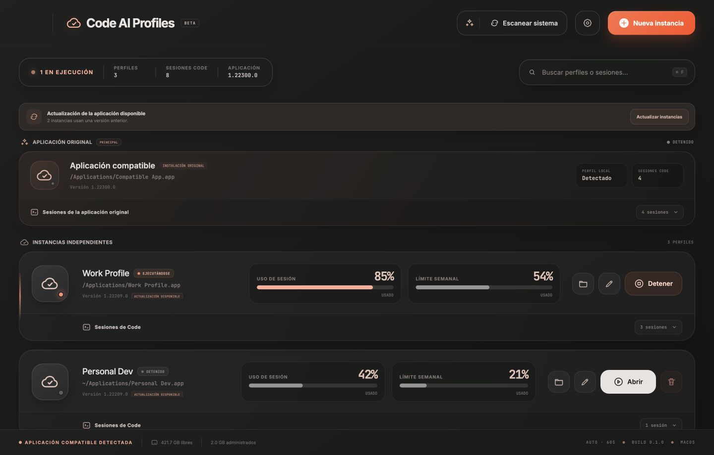
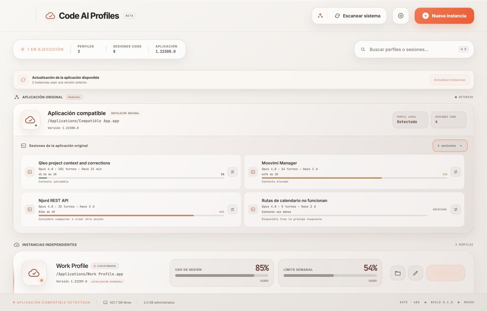

# Code AI Profiles

[](https://github.com/braiyan-chundo/code-ai-profiles/actions/workflows/validate.yml)
[](https://github.com/braiyan-chundo/code-ai-profiles/actions/workflows/build-desktop.yml)
[](LICENSE)

Aplicación de escritorio open source creada con Tauri, React y Rust para administrar perfiles aislados de una aplicación de IA compatible. Cada perfil mantiene sus propios datos, puede ejecutarse al mismo tiempo que los demás y ofrece una vista unificada de uso, sesiones y contexto.

> Estado: beta técnica. No uses perfiles ni sesiones irremplazables sin conservar un respaldo.





## Funciones principales

- Detecta automáticamente la aplicación compatible instalada y muestra su nombre real cuando los metadatos locales están disponibles.
- Crea perfiles independientes y los inicia de forma simultánea.
- Muestra el estado ejecutándose/detenido, la versión y el uso de sesión y semanal disponible.
- Escanea automáticamente cada 60 segundos y permite un escaneo manual con progreso visible.
- Detecta la instalación local válida más reciente y sincroniza las instancias administradas detenidas que estén detrás, incluso si la más reciente es otra instancia.
- Permite abrir el canal oficial para actualizar la aplicación original sin modificar perfiles ni actualizar instancias automáticamente.
- Incluye la instalación original en el mismo dashboard que las instancias administradas.
- Lista sesiones locales con título, modelo, turnos, actividad, estado archivado y contexto estimado.
- Permite desplegar o contraer las sesiones de cada perfil.
- Permite copiar, mover, devolver y desvincular sesiones entre perfiles detenidos; las copias locales de artefactos se exportan de forma segura cuando el schema de destino no está confirmado.
- Cierra instancias mediante una identidad de proceso verificada, con espera y escalación controlada si no terminan.
- Permite asignar un icono PNG o JPEG a cada instancia dentro de Code AI Profiles, sin alterar los binarios firmados del proveedor.
- Incluye temas claro, oscuro y del sistema, además de tres tamaños de texto para las sesiones.
- Usa controles de ventana apropiados para macOS y decoraciones compatibles en Windows y Linux.

## Plataformas

| Plataforma | Arquitectura | Paquetes | Estado |
| --- | --- | --- | --- |
| macOS | Apple Silicon | `.app`, `.dmg` | Compatible |
| Windows | x64 | `.msi`, `.exe` NSIS | Compatible |
| Linux | x64 y ARM64 | `.deb`, `.AppImage` | Compatible |

Los instaladores de cada plataforma se compilan en runners nativos mediante [`.github/workflows/build-desktop.yml`](.github/workflows/build-desktop.yml). Los paquetes generados aún no están firmados ni notarizados.

## Desarrollo local

Requisitos comunes:

- Node.js 24 y npm.
- Rust estable mediante `rustup`.
- Las dependencias de sistema de Tauri 2 para la plataforma.

Instala dependencias y abre el modo de desarrollo:

```bash
npm ci
npm run tauri -- dev
```

Verifica el frontend y las pruebas de Rust:

```bash
npm run build
npm run test:scan
cargo test --manifest-path src-tauri/Cargo.toml
```

## Versionado

El repositorio usa Semantic Versioning y actualmente está en `0.2.2`. Para preparar una versión compatible, una funcionalidad o un cambio incompatible, ejecuta:

```bash
npm run release:version -- patch
npm run release:version -- minor
npm run release:version -- major
npm run release:version -- 0.2.2
npm run release:check
```

`patch` corresponde a fixes compatibles, `minor` a funcionalidades compatibles y `major` a incompatibilidades. Mientras la versión sea `0.y.z`, un `minor` puede incluir incompatibilidades conforme al estándar; el proyecto procurará documentarlas de forma explícita. La herramienta sincroniza las fuentes de versión de Node y Tauri de forma atómica, y `release:check` comprueba que no diverjan. Cambiar una versión no publica un instalador ni crea una release. Consulta [la política completa](docs/versionado.document.md) y el [changelog](CHANGELOG.md).

## Desarrollo asistido por IA y Graphify

El repositorio sigue la metodología agéntica v4 (perfil S) con tres agentes: `architect`, `backend` y `frontend`. La configuración vive en [`.metodo/config.json`](.metodo/config.json) y el contrato generado está en [`AGENTS.md`](AGENTS.md). Toda feature o fix es una historia en [`hu/`](hu/INDEX.md) y se trabaja con `/hu-new`, `/hu-work`, `/hu-close` y `/fix`. Las historias y los roles anteriores se archivaron en [`docs/archivo/previo/`](docs/archivo/previo/) ([ADR-0001](docs/decisiones/ADR-0001-adopcion-metodologia-v4.md)).

Graphify mantiene un grafo local del código que debe consultarse antes del análisis y actualizarse al cerrar cada iteración. Instala la versión fijada por el proyecto y genera o actualiza sus artefactos:

```bash
uv tool install graphifyy==0.9.32
npm run graph:update
```

Antes de enviar cambios, comprueba que el grafo versionado coincide con el código:

```bash
npm run graph:check
```

El grafo se extrae localmente mediante AST y no requiere claves ni envía el código a un modelo externo. Consulta [la integración de Graphify](docs/graphify.document.md).

## Crear cada versión

Tauri recomienda compilar cada paquete en el sistema operativo de destino. El workflow de GitHub Actions contiene la matriz reproducible para las cuatro variantes publicadas.

### macOS Apple Silicon

Instala las herramientas de Xcode:

```bash
xcode-select --install
```

Compila la aplicación y el DMG:

```bash
npm ci
npm run build:macos
```

Resultados:

```text
src-tauri/target/release/bundle/macos/Code AI Profiles.app
src-tauri/target/release/bundle/dmg/*.dmg
```

Como referencia histórica, la entrega local de Apple Silicon `0.2.1` fue verificada. La generación de `0.2.2` se realiza únicamente después de que el merge protegido llegue a `main`; la ruta esperada del DMG y la `.app`, su hash y su verificación se reportan junto con ese artefacto. Un paquete local puede estar firmado ad-hoc y no estar notarizado, por lo que macOS puede requerir clic derecho → **Abrir**. Un artefacto local no implica una publicación o GitHub Release.

### Windows x64

Instala Microsoft C++ Build Tools con la carga de trabajo «Desktop development with C++», WebView2 y Rust para el target MSVC. Después ejecuta en PowerShell:

```powershell
npm ci
npm run build:windows
```

Resultados:

```text
src-tauri\target\release\bundle\msi\*.msi
src-tauri\target\release\bundle\nsis\*.exe
```

### Linux x64 o ARM64

En Ubuntu/Debian instala las dependencias usadas por el CI:

```bash
sudo apt-get update
sudo apt-get install -y libwebkit2gtk-4.1-dev libappindicator3-dev librsvg2-dev patchelf
```

Compila el paquete DEB y el AppImage en una máquina de la arquitectura objetivo:

```bash
npm ci
npm run build:linux
```

Resultados:

```text
src-tauri/target/release/bundle/deb/*.deb
src-tauri/target/release/bundle/appimage/*.AppImage
```

Para obtener todas las variantes desde GitHub, ejecuta manualmente el workflow **Build desktop installers** y descarga sus artifacts.

## Cómo funciona el aislamiento

Los perfiles administrados se guardan bajo el directorio de datos de Code AI Profiles:

```text
Code AI Profiles/
└── instances/
    └── <id>/
        ├── application/   copia o lanzador administrado
        └── profile/       datos independientes de la instancia
```

- En macOS se intenta usar clone-on-write de APFS y se conserva un bundle con el nombre del perfil para que Finder y el Dock lo identifiquen.
- En Windows se copia el directorio de la aplicación y cada proceso recibe su propio directorio de datos.
- En Linux se crea un lanzador hacia el binario instalado para conservar su sandbox y permitir que el gestor de paquetes actualice el ejecutable compartido.

La actualización de la aplicación original y la sincronización de instancias son operaciones separadas. En macOS, Code AI Profiles valida y abre exclusivamente la aplicación original; dentro de ella el usuario elige `Claude > Check for Updates`. En Windows abre la descarga oficial y en Linux las instrucciones apt. Nunca sobrescribe la original. Al volver del handoff, refresca únicamente versiones y topología, sin escaneo manual ni lectura de sesiones. Después, una instalación gestionada válida con la mayor versión puede sincronizar otras instancias detenidas sin tocar sus perfiles. Consulta [la guía de actualizaciones](docs/actualizaciones.document.md).

## Sesiones y contexto

El dashboard deserializa solamente una lista permitida de metadatos visuales. Para estimar el contexto, lee el uso de la respuesta principal más reciente y suma los tokens de entrada, creación de caché y lectura de caché; no carga ni muestra prompts, respuestas, razonamientos ni resultados de herramientas.

La ventana se elige según el modelo de esa respuesta: los modelos conocidos usan el límite documentado de 1 000 000 o 200 000 tokens. Para un modelo desconocido se conserva el conteo estimado, pero no se muestra un denominador, porcentaje o barra inventados.

Los umbrales son recomendaciones del proyecto:

- Menos de 70%: contexto saludable.
- Desde 70%: contexto elevado.
- Desde 90%: conviene compactar o iniciar una sesión nueva.

Después de una compactación, el valor se oculta hasta que exista una respuesta nueva. El conteo sigue siendo una estimación local y las tablas de modelos pueden evolucionar; consulta [la guía de sesiones y contexto](docs/sesiones.document.md) para ver el cálculo, las ventanas reconocidas y sus fuentes oficiales.

Las operaciones de sesión requieren que el origen y el destino estén detenidos:

- **Copiar** mantiene la sesión vinculada en el origen y el destino.
- **Mover** retira el índice del origen y conserva la relación para devolverla.
- **Devolver** restablece una sesión movida en su perfil de procedencia.
- **Desvincular** quita una copia del perfil secundario sin borrar su origen.

Las transferencias son experimentales. Conserva un respaldo y no abras simultáneamente una misma sesión copiada desde dos perfiles.

Las referencias cloud, la propiedad remota y los monitores de artefactos no se transfieren. Si se detectan archivos locales de artefactos, se preservan como una exportación administrada porque su schema de destino no se reconstruye de forma heurística. En un movimiento el material de origen permanece hasta que exista un registro de destino validado. Consulta [la guía de sesiones](docs/sesiones.document.md).

## Cierre e identidad visual de instancias

El botón **Detener** verifica que el proceso pertenezca a la aplicación y perfil de la instancia antes de cerrarlo, intenta un cierre normal y solo después escala dentro del árbol o grupo verificado. Si aún quedan procesos, conserva el estado ejecutándose y explica el error en vez de informar un cierre falso.

Puedes asignar un icono PNG o JPEG de hasta 5 MiB a cada instancia. El icono se muestra dentro de Code AI Profiles y sobrevive a la sincronización de su aplicación. En macOS, `NSWorkspace.setIcon` se está evaluando para el Dock, pero su metadata impide la verificación estricta mientras está aplicada; producción la revierte y conserva el icono personalizado dentro de Code AI Profiles. Windows conserva el icono del ejecutable firmado; Linux crea un launcher opcional cuyo resultado depende del compositor. Consulta [la guía de instancias](docs/instancias.document.md).

## Privacidad y seguridad

Code AI Profiles no descifra, copia ni muestra credenciales, cookies o tokens OAuth. El escaneo trabaja con archivos locales ya disponibles para el usuario y falla de forma segura si un formato deja de ser compatible.

No incluyas datos reales de cuentas, perfiles, transcripts o credenciales en issues, pull requests o capturas públicas.

## Compatibilidad actual y marcas

La primera integración compatible es Claude Desktop y sus sesiones locales de Claude Code. La detección depende de nombres de ejecutables, rutas y formatos locales de estos productos, por lo que algunas referencias técnicas se conservan únicamente dentro de la capa de integración.

Code AI Profiles es un proyecto independiente: no está afiliado, respaldado ni aprobado por Anthropic. Claude, Claude Desktop y Claude Code son marcas de sus respectivos titulares. La arquitectura y la marca del proyecto son neutrales para permitir soporte futuro de otras aplicaciones, pero ninguna integración adicional se anuncia todavía.

Para no perder los datos de instalaciones anteriores, el identificador interno heredado `com.braiyan.claudeprofiles` se mantiene de forma intencional. No es el nombre público del producto.

## Contribuir

La rama predeterminada es `develop`. Antes de programar:

1. Abre un issue con tu propuesta.
2. Espera autorización explícita de `@braiyan-chundo`.
3. Envía el pull request exclusivamente hacia `develop`.

`main` contiene publicaciones estables y solo el mantenedor puede actualizarla mediante un pull request desde `develop`. Los PR externos hacia `main` se cierran automáticamente. Consulta [CONTRIBUTING.md](CONTRIBUTING.md) para conocer el proceso completo.

## Licencia

Distribuido bajo [Apache License 2.0](LICENSE). Esta licencia permite uso, modificación y distribución, incluye una concesión expresa de patentes y exige conservar los avisos aplicables.
